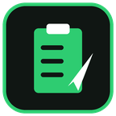
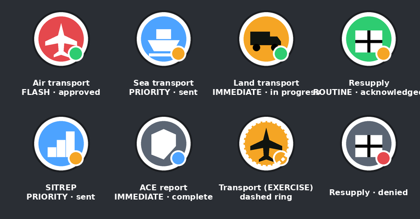

# TakRequest for ATAK

An ATAK plugin for **requests and reporting**: transport (air/sea/land), resupply, SITREP and ACE
reports, on a shared board and on the map, exchanged as standard Cursor-on-Target (CoT) with a simple
approval workflow and EXERCISE / MILSIM / TRAINING modes.

> **Status: early test build (v0.1).** Compiles against the ATAK-CIV 5.5.0 SDK and the core logic is
> unit-tested; not yet exercised on a device.

**Scope:** this is a coordination and reporting tool. It is **not** a targeting or fire-support
system — there is no call-for-fire, CAS 9-line or weapon-tasking content, by design.

## What it does

- **Request board**, open requests first, colour-coded by priority.
- **Transport**: carrier, load, pickup and destination, personnel/vehicles/cargo, time window, comms,
  and a landing-zone block for air moves.
- **Resupply**: itemised by NATO class of supply, with a delivery point.
- **SITREP** and **ACE/LACE** reports.
- **Map markers**: glyph by kind, colour by priority, status dot, dashed ring for non-real modes.
- **Status workflow** and **team sync** over CoT (most recent edit wins).
- **Plain-text report** on every marker, so clients without the plugin (including iTAK) can read it.

## Map markers

Colour is the priority, the glyph is the kind (aircraft/ship/truck for transport, box for resupply,
bars for SITREP, shield for ACE), the small dot is the status, and a dashed ring marks a non-real mode.

This is a design preview drawn from the plugin's geometry and colours, not a device screenshot.

## Platforms

| Platform | State |
|---|---|
| ATAK (Android) | v0.1, this repository |
| WinTAK (Windows) | Planned; will share the CoT format in `docs/COT-SPEC.md` |
| iTAK (iOS) | No plugin possible on iOS; iTAK users see the markers and text reports |

## Building

The ATAK SDK is not included and cannot be redistributed. Download it from tak.gov.

1. Clone into `<ATAK SDK>/samples/takrequest`.
2. Create `local.properties` with `sdk.dir=<path to your Android SDK>`.
3. `./gradlew assembleCivDebug` (loads only in the SDK's developer ATAK).

For a signed build that runs on ATAK from Google Play, run `scripts/package-submission.sh <version>`
and upload the zip from `dist/` at tak.gov/user_builds.

Core tests need no SDK:

    ./gradlew -p core test
